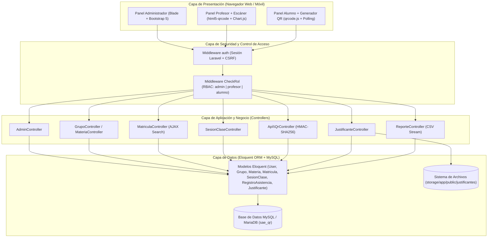
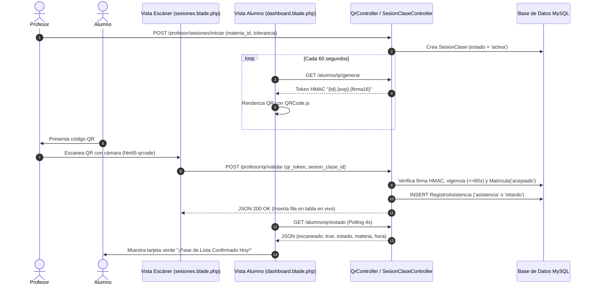

# Manual Técnico del Sistema — SAE QR (Ámbito Universitario)

**Proyecto:** Sistema de Asistencia Escolar mediante Códigos QR Dinámicos (`SAE QR`)  
**Versión del Sistema:** `2.0.0` (Edición Universitaria Modular)  
**Framework Base:** Laravel `12.x` (`PHP ^8.2`)  
**Motor de Base de Datos:** MySQL / MariaDB (`InnoDB`)

---

## 1. Arquitectura General del Sistema

### 1.1. Patrón Arquitectónico (MVC + Servicios Asíncronos Híbridos)
El sistema **SAE QR** está construido bajo el patrón arquitectónico **Modelo-Vista-Controlador (MVC)** provisto por **Laravel 12**, complementado con un modelo de **comunicación asíncrona híbrida (AJAX / Fetch JSON)** para las operaciones críticas en tiempo real (emisión de tokens QR efímeros, lectura por cámara web/móvil, confirmación en vivo de pase de lista y búsquedas dinámicas sobre padrones extensos).



### 1.2. Principios de Diseño del Dominio Universitario Modular
1. **Desacoplamiento Grupo–Docente (Gestión Modular):**
   - Un `Grupo` representa una cohorte oficial universitaria definida por `nombre_grupo`, `carrera`, `grado` (Semestre `1°` a `12°`), `turno` y `periodo_lectivo`.
   - Un grupo no pertenece de forma exclusiva a un único maestro; cada `Materia` dentro del grupo tiene su propio `profesor_id`.
   - La entidad `SesionClase` vincula de forma ternaria **`profesor_id` + `grupo_id` + `materia_id`**.
2. **Matrícula Granular por Asignatura:**
   - La entidad `Matricula` aplica una restricción única compuesta `(user_id, grupo_id, materia_id)`, permitiendo que alumnos regulares o irregulares cursen materias en distintos grupos y turnos.
3. **Reglamento Académico Automatizado:**
   - **Regla `3 Retardos = 1 Falta`:** El cálculo de faltas computadas por asignatura aplica división entera `intdiv($retardos, 3)` sumada a las faltas directas.
   - **Derecho a Examen Ordinario:** Límite estricto de 3 faltas computadas por asignatura (`0-1`: *Con Derecho a Ordinario*, `2`: *En Riesgo / Preventivo*, `>=3`: *Sin Derecho a Examen - SD*).

### 1.3. Arquitectura de Seguridad
- **Control de Acceso Basado en Roles (RBAC):** Implementado en `app/Http/Middleware/CheckRol.php`, el cual intercepta cada petición HTTP autenticada y valida que `Auth::user()->rol` coincida con el rol exigido por el grupo de rutas (`admin`, `profesor`, `alumno`).
- **Prevención de Falsificación de QR (Anti-Spoofing / Anti-Replay):** Los códigos QR utilizan una firma criptográfica simétrica **`HMAC-SHA256`** derivada de la llave privada del servidor (`config('app.key')`) con una ventana de expiración (`TTL`) de **60 segundos** y verificación en tiempo constante mediante `hash_equals()`.
- **Protección Anti-IDOR (Insecure Direct Object Reference):** Todos los controladores verifican explícitamente que las sesiones, materias, matrículas y justificantes manipulados pertenezcan al `Auth::id()` en sesión antes de ejecutar operaciones de lectura o escritura.

---

## 2. Stack Tecnológico Completo

### 2.1. Backend y Servidor
| Componente | Tecnología | Versión | Ubicación / Configuración |
| :--- | :--- | :--- | :--- |
| **Lenguaje de Servidor** | PHP | `^8.2` (`8.2.12`) | `C:\xampp\php\php.exe` |
| **Framework Principal** | Laravel Framework | `^12.0` | `composer.json` |
| **ORM y Abstracción BD** | Eloquent ORM / PDO MySQL | Integrado en Laravel 12 | `app/Models/` |
| **Autenticación API/Tokens** | Laravel Sanctum / JWT Auth | `^4.0` / `^2.3` | `composer.json` |
| **Manejo de Fechas y Tiempo** | Carbon | `^3.x` | Integrado en `nesbot/carbon` |
| **Servidor Web Local** | Apache (XAMPP) / Artisan Serve | Apache `2.4` | `c:\xampp\htdocs\sae_qr` |

### 2.2. Base de Datos
| Componente | Especificación | Detalle Técnico |
| :--- | :--- | :--- |
| **SGBD** | MySQL / MariaDB | Motor transaccional `InnoDB` |
| **Codificación** | `utf8mb4` / `utf8mb4_unicode_ci` | Soporte completo para caracteres en español |
| **Puerto de Conexión** | `3307` (XAMPP) / `3306` (Estándar) | Configurable en `.env` (`DB_PORT`) |

### 2.3. Frontend y Librerías Cliente
| Librería / API | Versión | Propósito Técnico | Vista donde opera |
| :--- | :--- | :--- | :--- |
| **Bootstrap 5** | `5.3.0` | Sistema de grillas responsivo, modales, alertas y componentes UI | Todas las vistas Blade |
| **Bootstrap Icons** | `1.10.5` | Iconografía vectorial semántica | Todas las vistas Blade |
| **QRCode.js** | `1.0.0` | Renderizado en cliente de matriz QR (`210x210 px`, nivel `L`) | `resources/views/alumno/dashboard.blade.php` |
| **html5-qrcode** | `2.3.x` | Decodificación de stream de video WebRTC y `BarCodeDetector` | `resources/views/profesor/sesiones.blade.php` |
| **Chart.js** | `4.4.1` | Renderizado en `<canvas>` de gráficas Doughnut y Bar | `profesor/dashboard.blade.php`, `grupos/show.blade.php` |

---

## 3. Detalles de la Base de Datos (Diccionario de Datos e Índices)

El esquema relacional consta de **8 tablas de dominio** gestionadas mediante migraciones secuenciales en `database/migrations/`.

### 3.1. Tabla `users` (Usuarios del Sistema)
| Columna | Tipo de Dato | Nulo | Índices / Restricciones | Descripción |
| :--- | :--- | :---: | :--- | :--- |
| `id` | `BIGINT UNSIGNED` | No | `PK`, `AUTO_INCREMENT` | Identificador único del usuario |
| `name` | `VARCHAR(255)` | No | — | Nombre completo del usuario |
| `email` | `VARCHAR(255)` | No | `UNIQUE` (`users_email_unique`) | Correo electrónico institucional o personal |
| `password` | `VARCHAR(255)` | No | — | Hash Bcrypt de la contraseña |
| `rol` | `ENUM('admin','profesor','alumno')` | No | Default: `'alumno'` | Nivel de privilegio en el sistema |
| `matricula_codigo` | `VARCHAR(255)` | Sí | `UNIQUE` (`users_matricula_codigo_unique`) | Matrícula estudiantil o clave docente |
| `created_at` / `updated_at` | `TIMESTAMP` | Sí | — | Marcas de auditoría |

### 3.2. Tabla `codigos_docentes` (Códigos de Invitación para Profesores)
| Columna | Tipo de Dato | Nulo | Índices / Restricciones | Descripción |
| :--- | :--- | :---: | :--- | :--- |
| `id` | `BIGINT UNSIGNED` | No | `PK`, `AUTO_INCREMENT` | Identificador del código |
| `codigo` | `VARCHAR(30)` | No | `UNIQUE` | Código alfanumérico (ej. `DOC-8F2A-26`) |
| `descripcion_nota` | `VARCHAR(150)` | Sí | — | Referencia opcional del destinatario |
| `usado` | `BOOLEAN` | No | Default: `0` (`false`) | Indica si ya fue canjeado |
| `usado_por_id` | `BIGINT UNSIGNED` | Sí | `FK -> users(id) ON DELETE SET NULL` | Docente que canjeó el código |
| `creado_por_id` | `BIGINT UNSIGNED` | Sí | `FK -> users(id) ON DELETE SET NULL` | Administrador que emitió el código |
| `usado_en` | `TIMESTAMP` | Sí | — | Fecha y hora exacta del canje |

### 3.3. Tabla `grupos` (Catálogo Oficial de Grupos Universitarios)
| Columna | Tipo de Dato | Nulo | Índices / Restricciones | Descripción |
| :--- | :--- | :---: | :--- | :--- |
| `id` | `BIGINT UNSIGNED` | No | `PK`, `AUTO_INCREMENT` | Identificador del grupo |
| `nombre_grupo` | `VARCHAR(255)` | No | `UNIQUE(nombre_grupo, turno)` | Clave del grupo (ej. `ISC-701`, `S7B`) |
| `carrera` | `VARCHAR(120)` | Sí | — | Programa educativo (ej. `Ingeniería en Sistemas Computacionales`) |
| `grado` | `VARCHAR(255)` | No | — | Semestre académico (`1° Semestre` a `12° Semestre`) |
| `turno` | `VARCHAR(255)` | No | `UNIQUE(nombre_grupo, turno)` | `Matutino`, `Vespertino`, `Nocturno`, `Mixto / Sabatino` |
| `periodo_lectivo` | `VARCHAR(255)` | No | — | Ciclo escolar (ej. `Ago-Dic 2026`) |
| `profesor_id` | `BIGINT UNSIGNED` | Sí | `FK -> users(id) ON DELETE CASCADE` | Opcional en modelo universitario |

### 3.4. Tabla `materias` (Asignaturas Impartidas por Grupo y Docente)
| Columna | Tipo de Dato | Nulo | Índices / Restricciones | Descripción |
| :--- | :--- | :---: | :--- | :--- |
| `id` | `BIGINT UNSIGNED` | No | `PK`, `AUTO_INCREMENT` | Identificador de la asignatura |
| `nombre_materia` | `VARCHAR(255)` | No | `UNIQUE(grupo_id, nombre_materia)` | Nombre de la asignatura |
| `codigo_materia` | `VARCHAR(255)` | No | `UNIQUE(grupo_id, codigo_materia)` | Clave curricular (ej. `ING-301`) |
| `grupo_id` | `BIGINT UNSIGNED` | Sí | `FK -> grupos(id) ON DELETE CASCADE` | Grupo donde se imparte |
| `profesor_id` | `BIGINT UNSIGNED` | Sí | `FK -> users(id) ON DELETE SET NULL` | Docente titular que imparte la asignatura |

### 3.5. Tabla `matriculas` (Inscripciones Individuales por Asignatura)
| Columna | Tipo de Dato | Nulo | Índices / Restricciones | Descripción |
| :--- | :--- | :---: | :--- | :--- |
| `id` | `BIGINT UNSIGNED` | No | `PK`, `AUTO_INCREMENT` | Identificador de la inscripción |
| `user_id` | `BIGINT UNSIGNED` | No | `FK -> users(id) ON DELETE CASCADE` | Estudiante inscrito |
| `grupo_id` | `BIGINT UNSIGNED` | No | `FK -> grupos(id) ON DELETE CASCADE` | Grupo asociado |
| `materia_id` | `BIGINT UNSIGNED` | Sí | `FK -> materias(id) ON DELETE CASCADE` | Asignatura asociada |
| `estado` | `ENUM('pendiente','aceptado','rechazado')` | No | Default: `'pendiente'` | Estado de aprobación por el docente |
| *Índice Compuesto* | `UNIQUE(user_id, grupo_id, materia_id)` | — | `matriculas_user_grupo_materia_unique` | Evita inscripciones duplicadas en la misma materia |

### 3.6. Tabla `sesion_clases` (Sesiones de Clase y Pase de Lista)
| Columna | Tipo de Dato | Nulo | Índices / Restricciones | Descripción |
| :--- | :--- | :---: | :--- | :--- |
| `id` | `BIGINT UNSIGNED` | No | `PK`, `AUTO_INCREMENT` | Identificador de la sesión |
| `profesor_id` | `BIGINT UNSIGNED` | No | `FK -> users(id) ON DELETE CASCADE` | Docente que abre la sesión |
| `grupo_id` | `BIGINT UNSIGNED` | Sí | `FK -> grupos(id) ON DELETE CASCADE` | Grupo de la sesión |
| `materia_id` | `BIGINT UNSIGNED` | No | `FK -> materias(id) ON DELETE CASCADE` | Asignatura impartida |
| `fecha` | `DATE` | No | — | Fecha calendario (`YYYY-MM-DD`) |
| `hora_inicio` | `TIME` | No | — | Hora exacta de apertura (`HH:MM:SS`) |
| `hora_fin` | `TIME` | No | — | Hora de cierre de sesión |
| `tolerancia_minutos` | `INT` | No | Default: `10` | Minutos antes de marcar `retardo` |
| `estado` | `ENUM('activa','finalizada')` | No | Default: `'activa'` | Estado operativo del escáner |

### 3.7. Tabla `registro_asistencias` (Registros de Asistencia por Sesión)
| Columna | Tipo de Dato | Nulo | Índices / Restricciones | Descripción |
| :--- | :--- | :---: | :--- | :--- |
| `id` | `BIGINT UNSIGNED` | No | `PK`, `AUTO_INCREMENT` | Identificador del pase de lista |
| `sesion_clase_id` | `BIGINT UNSIGNED` | No | `FK -> sesion_clases(id) ON DELETE CASCADE` | Sesión de clase correspondiente |
| `user_id` | `BIGINT UNSIGNED` | No | `FK -> users(id) ON DELETE CASCADE` | Alumno evaluado |
| `timestamp_escaneo` | `TIMESTAMP` | Sí | — | Momento exacto del escaneo QR (`NULL` si fue falta automática) |
| `estado_incidencia` | `ENUM('asistencia','retardo','falta','permiso')` | No | Default: `'falta'` | Incidencia computada |
| `observaciones` | `VARCHAR(255)` | Sí | — | Trazabilidad (ej. `Registrado por escaneo QR`) |

### 3.8. Tabla `justificantes` (Comprobantes Digitales y Revisión Docente)
| Columna | Tipo de Dato | Nulo | Índices / Restricciones | Descripción |
| :--- | :--- | :---: | :--- | :--- |
| `id` | `BIGINT UNSIGNED` | No | `PK`, `AUTO_INCREMENT` | Identificador del justificante |
| `registro_id` | `BIGINT UNSIGNED` | No | `FK -> registro_asistencias(id) ON DELETE CASCADE` | Falta o retardo que se solicita justificar |
| `motivo` | `TEXT` | No | — | Explicación escrita por el estudiante |
| `comentario_profesor` | `VARCHAR(500)` | Sí | — | Observación opcional del docente al aprobar o rechazar |
| `documento_url` | `VARCHAR(255)` | Sí | — | Ruta relativa en `storage/app/public/justificantes/` |
| `estado_aprobacion` | `ENUM('pendiente','aceptado','rechazado')` | No | Default: `'pendiente'` | Estado de dictamen |

---

## 4. APIs Internas, Endpoints AJAX e Integraciones Principales

| Endpoint | Método | Controlador | Propósito |
| :--- | :---: | :--- | :--- |
| `/alumno/qr/generar` | `GET` | `Api\QrController@generarTokenQR` | Genera token firmado `HMAC-SHA256` (`{id}.{exp}.{firma16}`) con TTL de 60 s |
| `/profesor/qr/validar` | `POST` | `Api\QrController@validarEscaneo` | Valida firma HMAC, vigencia, matrícula activa y registra `asistencia` o `retardo` |
| `/alumno/qr/estado` | `GET` | `Api\QrController@verificarEscaneoReciente` | Polling ligero (cada 4 s) para mostrar confirmación en vivo al alumno |
| `/profesor/alumnos/buscar` | `GET` | `MatriculaController@buscarAlumnos` | Búsqueda asíncrona de alumnos por nombre, matrícula o correo (máx. 15 resultados) |
| `/alumno/grupos/{grupo}/materias` | `GET` | `MatriculaController@materiasPorGrupo` | Carga dinámica de asignaturas e indicador de inscripción previa por grupo |

---

## 5. Diagramas Clave de Flujo y UML

### 5.1. Diagrama de Secuencia del Pase de Lista QR



---

## 6. Procedimiento Detallado de Instalación y Despliegue (Entorno de Desarrollo)

1. **Instalar dependencias de PHP:**
   ```powershell
   cd c:\xampp\htdocs\sae_qr
   composer install
   ```
2. **Configurar variables de entorno y generar llave criptográfica:**
   ```powershell
   copy .env.example .env
   php artisan key:generate
   ```
   Configurar en `.env`:
   ```env
   DB_CONNECTION=mysql
   DB_HOST=127.0.0.1
   DB_PORT=3307
   DB_DATABASE=sae_qr
   DB_USERNAME=root
   DB_PASSWORD=
   ```
3. **Ejecutar migraciones y enlace simbólico de almacenamiento:**
   ```powershell
   php artisan migrate
   php artisan storage:link
   ```
4. **Crear cuenta de Administrador inicial (si la base de datos está limpia):**
   ```powershell
   php artisan tinker --execute="\App\Models\User::updateOrCreate(['email' => 'admin@saeqr.com'], ['name' => 'Administrador General', 'password' => \Illuminate\Support\Facades\Hash::make('admin123'), 'rol' => 'admin']);"
   ```
5. **Iniciar el servidor de desarrollo:**
   - Vía XAMPP Apache: `http://localhost/sae_qr/public/login`
   - Vía Artisan CLI: `php artisan serve` (`http://127.0.0.1:8000/login`)

### 3.1. Tabla `users` (Usuarios del Sistema)
| Columna | Tipo de Dato | Nulo | Índices / Restricciones | Descripción |
| :--- | :--- | :---: | :--- | :--- |
| `id` | `BIGINT UNSIGNED` | No | `PK`, `AUTO_INCREMENT` | Identificador único del usuario |
| `name` | `VARCHAR(255)` | No | — | Nombre completo del usuario |
| `email` | `VARCHAR(255)` | No | `UNIQUE` (`users_email_unique`) | Correo electrónico institucional o personal |
| `password` | `VARCHAR(255)` | No | — | Hash Bcrypt de la contraseña |
| `rol` | `ENUM('admin','profesor','alumno')` | No | Default: `'alumno'` | Nivel de privilegio en el sistema |
| `matricula_codigo` | `VARCHAR(255)` | Sí | `UNIQUE` (`users_matricula_codigo_unique`) | Matrícula estudiantil o clave docente |
| `created_at` / `updated_at` | `TIMESTAMP` | Sí | — | Marcas de auditoría |

### 3.2. Tabla `codigos_docentes` (Códigos de Invitación para Profesores)
| Columna | Tipo de Dato | Nulo | Índices / Restricciones | Descripción |
| :--- | :--- | :---: | :--- | :--- |
| `id` | `BIGINT UNSIGNED` | No | `PK`, `AUTO_INCREMENT` | Identificador del código |
| `codigo` | `VARCHAR(30)` | No | `UNIQUE` | Código alfanumérico (ej. `DOC-8F2A-26`) |
| `descripcion_nota` | `VARCHAR(150)` | Sí | — | Referencia opcional del destinatario |
| `usado` | `BOOLEAN` | No | Default: `0` (`false`) | Indica si ya fue canjeado |
| `usado_por_id` | `BIGINT UNSIGNED` | Sí | `FK -> users(id) ON DELETE SET NULL` | Docente que canjeó el código |
| `creado_por_id` | `BIGINT UNSIGNED` | Sí | `FK -> users(id) ON DELETE SET NULL` | Administrador que emitió el código |
| `usado_en` | `TIMESTAMP` | Sí | — | Fecha y hora exacta del canje |

### 3.3. Tabla `grupos` (Catálogo Oficial de Grupos Universitarios)
| Columna | Tipo de Dato | Nulo | Índices / Restricciones | Descripción |
| :--- | :--- | :---: | :--- | :--- |
| `id` | `BIGINT UNSIGNED` | No | `PK`, `AUTO_INCREMENT` | Identificador del grupo |
| `nombre_grupo` | `VARCHAR(255)` | No | `UNIQUE(nombre_grupo, turno)` | Clave del grupo (ej. `ISC-701`, `S7B`) |
| `carrera` | `VARCHAR(120)` | Sí | — | Programa educativo (ej. `Ingeniería en Sistemas Computacionales`) |
| `grado` | `VARCHAR(255)` | No | — | Semestre académico (`1° Semestre` a `12° Semestre`) |
| `turno` | `VARCHAR(255)` | No | `UNIQUE(nombre_grupo, turno)` | `Matutino`, `Vespertino`, `Nocturno`, `Mixto / Sabatino` |
| `periodo_lectivo` | `VARCHAR(255)` | No | — | Ciclo escolar (ej. `Ago-Dic 2026`) |
| `profesor_id` | `BIGINT UNSIGNED` | Sí | `FK -> users(id) ON DELETE CASCADE` | Opcional en modelo universitario |

### 3.4. Tabla `materias` (Asignaturas Impartidas por Grupo y Docente)
| Columna | Tipo de Dato | Nulo | Índices / Restricciones | Descripción |
| :--- | :--- | :---: | :--- | :--- |
| `id` | `BIGINT UNSIGNED` | No | `PK`, `AUTO_INCREMENT` | Identificador de la asignatura |
| `nombre_materia` | `VARCHAR(255)` | No | `UNIQUE(grupo_id, nombre_materia)` | Nombre de la asignatura |
| `codigo_materia` | `VARCHAR(255)` | No | `UNIQUE(grupo_id, codigo_materia)` | Clave curricular (ej. `ING-301`) |
| `grupo_id` | `BIGINT UNSIGNED` | Sí | `FK -> grupos(id) ON DELETE CASCADE` | Grupo donde se imparte |
| `profesor_id` | `BIGINT UNSIGNED` | Sí | `FK -> users(id) ON DELETE SET NULL` | Docente titular que imparte la asignatura |

### 3.5. Tabla `matriculas` (Inscripciones Individuales por Asignatura)
| Columna | Tipo de Dato | Nulo | Índices / Restricciones | Descripción |
| :--- | :--- | :---: | :--- | :--- |
| `id` | `BIGINT UNSIGNED` | No | `PK`, `AUTO_INCREMENT` | Identificador de la inscripción |
| `user_id` | `BIGINT UNSIGNED` | No | `FK -> users(id) ON DELETE CASCADE` | Estudiante inscrito |
| `grupo_id` | `BIGINT UNSIGNED` | No | `FK -> grupos(id) ON DELETE CASCADE` | Grupo asociado |
| `materia_id` | `BIGINT UNSIGNED` | Sí | `FK -> materias(id) ON DELETE CASCADE` | Asignatura asociada |
| `estado` | `ENUM('pendiente','aceptado','rechazado')` | No | Default: `'pendiente'` | Estado de aprobación por el docente |
| *Índice Compuesto* | `UNIQUE(user_id, grupo_id, materia_id)` | — | `matriculas_user_grupo_materia_unique` | Evita inscripciones duplicadas en la misma materia |

### 3.6. Tabla `sesion_clases` (Sesiones de Clase y Pase de Lista)
| Columna | Tipo de Dato | Nulo | Índices / Restricciones | Descripción |
| :--- | :--- | :---: | :--- | :--- |
| `id` | `BIGINT UNSIGNED` | No | `PK`, `AUTO_INCREMENT` | Identificador de la sesión |
| `profesor_id` | `BIGINT UNSIGNED` | No | `FK -> users(id) ON DELETE CASCADE` | Docente que abre la sesión |
| `grupo_id` | `BIGINT UNSIGNED` | Sí | `FK -> grupos(id) ON DELETE CASCADE` | Grupo de la sesión |
| `materia_id` | `BIGINT UNSIGNED` | No | `FK -> materias(id) ON DELETE CASCADE` | Asignatura impartida |
| `fecha` | `DATE` | No | — | Fecha calendario (`YYYY-MM-DD`) |
| `hora_inicio` | `TIME` | No | — | Hora exacta de apertura (`HH:MM:SS`) |
| `hora_fin` | `TIME` | No | — | Hora de cierre de sesión |
| `tolerancia_minutos` | `INT` | No | Default: `10` | Minutos antes de marcar `retardo` |
| `estado` | `ENUM('activa','finalizada')` | No | Default: `'activa'` | Estado operativo del escáner |

### 3.7. Tabla `registro_asistencias` (Registros de Asistencia por Sesión)
| Columna | Tipo de Dato | Nulo | Índices / Restricciones | Descripción |
| :--- | :--- | :---: | :--- | :--- |
| `id` | `BIGINT UNSIGNED` | No | `PK`, `AUTO_INCREMENT` | Identificador del pase de lista |
| `sesion_clase_id` | `BIGINT UNSIGNED` | No | `FK -> sesion_clases(id) ON DELETE CASCADE` | Sesión de clase correspondiente |
| `user_id` | `BIGINT UNSIGNED` | No | `FK -> users(id) ON DELETE CASCADE` | Alumno evaluado |
| `timestamp_escaneo` | `TIMESTAMP` | Sí | — | Momento exacto del escaneo QR (`NULL` si fue falta automática) |
| `estado_incidencia` | `ENUM('asistencia','retardo','falta','permiso')` | No | Default: `'falta'` | Incidencia computada |
| `observaciones` | `VARCHAR(255)` | Sí | — | Trazabilidad (ej. `Registrado por escaneo QR`) |

### 3.8. Tabla `justificantes` (Comprobantes Digitales y Revisión Docente)
| Columna | Tipo de Dato | Nulo | Índices / Restricciones | Descripción |
| :--- | :--- | :---: | :--- | :--- |
| `id` | `BIGINT UNSIGNED` | No | `PK`, `AUTO_INCREMENT` | Identificador del justificante |
| `registro_id` | `BIGINT UNSIGNED` | No | `FK -> registro_asistencias(id) ON DELETE CASCADE` | Falta o retardo que se solicita justificar |
| `motivo` | `TEXT` | No | — | Explicación escrita por el estudiante |
| `comentario_profesor` | `VARCHAR(500)` | Sí | — | Observación opcional del docente al aprobar o rechazar |
| `documento_url` | `VARCHAR(255)` | Sí | — | Ruta relativa en `storage/app/public/justificantes/` |
| `estado_aprobacion` | `ENUM('pendiente','aceptado','rechazado')` | No | Default: `'pendiente'` | Estado de dictamen |

---

## 4. APIs Internas, Endpoints AJAX e Integraciones Principales

| Endpoint | Método | Controlador | Propósito |
| :--- | :---: | :--- | :--- |
| `/alumno/qr/generar` | `GET` | `Api\QrController@generarTokenQR` | Genera token firmado `HMAC-SHA256` (`{id}.{exp}.{firma16}`) con TTL de 60 s |
| `/profesor/qr/validar` | `POST` | `Api\QrController@validarEscaneo` | Valida firma HMAC, vigencia, matrícula activa y registra `asistencia` o `retardo` |
| `/alumno/qr/estado` | `GET` | `Api\QrController@verificarEscaneoReciente` | Polling ligero (cada 4 s) para mostrar confirmación en vivo al alumno |
| `/profesor/alumnos/buscar` | `GET` | `MatriculaController@buscarAlumnos` | Búsqueda asíncrona de alumnos por nombre, matrícula o correo (máx. 15 resultados) |
| `/alumno/grupos/{grupo}/materias` | `GET` | `MatriculaController@materiasPorGrupo` | Carga dinámica de asignaturas e indicador de inscripción previa por grupo |

---

## 5. Diagramas Clave de Flujo y UML

### 5.1. Diagrama de Secuencia del Pase de Lista QR


---

## 6. Procedimiento Detallado de Instalación y Despliegue (Entorno de Desarrollo)

1. **Instalar dependencias de PHP:**
   ```powershell
   cd c:\xampp\htdocs\sae_qr
   composer install
   ```
2. **Configurar variables de entorno y generar llave criptográfica:**
   ```powershell
   copy .env.example .env
   php artisan key:generate
   ```
   Configurar en `.env`:
   ```env
   DB_CONNECTION=mysql
   DB_HOST=127.0.0.1
   DB_PORT=3307
   DB_DATABASE=sae_qr
   DB_USERNAME=root
   DB_PASSWORD=
   ```
3. **Ejecutar migraciones y enlace simbólico de almacenamiento:**
   ```powershell
   php artisan migrate
   php artisan storage:link
   ```
4. **Crear cuenta de Administrador inicial (si la base de datos está limpia):**
   ```powershell
   php artisan tinker --execute="\App\Models\User::updateOrCreate(['email' => 'admin@saeqr.com'], ['name' => 'Administrador General', 'password' => \Illuminate\Support\Facades\Hash::make('admin123'), 'rol' => 'admin']);"
   ```
5. **Iniciar el servidor de desarrollo:**
   - Vía XAMPP Apache: `http://localhost/sae_qr/public/login`
   - Vía Artisan CLI: `php artisan serve` (`http://127.0.0.1:8000/login`)

